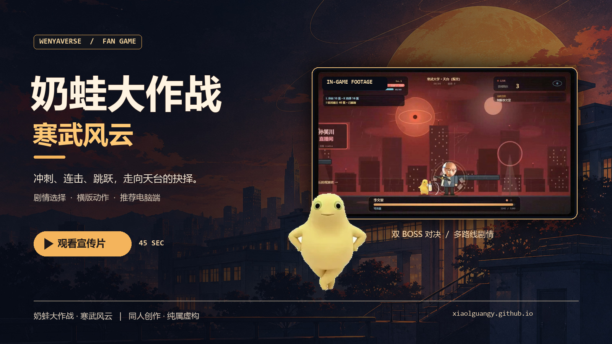

<div align="center">

# 奶蛙大作战 · 寒武风云

**横版动作 × 剧情选择 × 文亚宇宙同人冒险**

和奶蛙一起出发，穿过花场、校园与天文台，走向天台上的最后抉择。

[**🎮 立即游玩**](https://xiaolguangy.github.io/naiwa-game/) · [观看宣传片](https://xiaolguangy.github.io/naiwa-game/media/trailer.mp4) · [操作指南](#操作指南) · [参与贡献](#参与贡献)


[](https://xiaolguangy.github.io/naiwa-game/media/trailer.mp4)

<sub>点击封面观看 45 秒宣传片 · 推荐电脑端游玩</sub>

</div>

---

## 进入寒武风云

奶蛙与李文亚踏上一段充满岔路的旅程：收集线索、应对敌人、参加一场又一场荒诞的会议，最后在天台作出选择。战斗与剧情选择会把故事引向不同路线，游戏内共有六种结局可收录。

| 动作与冒险 | 故事与选择 | 随时开玩 |
| :--- | :--- | :--- |
| 连击、二段跳、冲刺、奶瓶飞弹和大招 | 探索关卡、应对 Boss，决定故事走向 | 无需安装，打开浏览器即可游玩 |

> 本作是文亚宇宙同人创作，人物与情节均为虚构，与现实人物及机构无隶属关系。游戏内部分剧情使用 AI 合成配音。

## 操作指南

**推荐电脑端游玩。** 手机请横屏：左侧按住并左右滑动移动，松手停止；右侧按键负责战斗，支持双手同时操作。

| 电脑按键 | 操作 |
| :--- | :--- |
| `A` / `D` 或 `←` / `→` | 左右移动 |
| `空格` / `W` | 跳跃；空中再按一次可二段跳 |
| `J` | 普通攻击、连击 |
| `K` | 奶瓶飞弹 |
| `L` / `Shift` | 冲刺 |
| `I` | 大招「银河灌注」 |
| `Esc` / `M` | 暂停 / 静音 |

游戏内「操作说明」包含更多按键。音频需要先与页面交互；若没有声音，请检查静音设置。

## 本地运行

游戏是静态网页，无需构建。克隆仓库后，在项目目录启动静态文件服务器：

```bash
git clone https://github.com/XiaolGuangy/naiwa-game.git
cd naiwa-game
python -m http.server 8000
```

然后访问 <http://localhost:8000/>。游戏进度保存在浏览器本地存储中。

## 检查移动端交互

安装 Node.js 后运行：

```bash
npm install
npx playwright install chromium
npm test
```

测试覆盖左右滑动、反向、松手、多指操作与按键尺寸。如需使用已安装的浏览器，可将 `BROWSER_PATH` 设置为其可执行文件路径。

## 授权与素材

游戏代码采用 [MIT 许可证](LICENSE)。`assets/` 和 `media/` 下的人物照片、音频、视频及其他素材可能涉及第三方权利，**不包含在代码的 MIT 许可范围内**；再次使用前请自行核实并取得所需授权。项目发布者确认已取得本项目公开发布所需许可。

部分人物图片参考了 [李文亚 Wiki](https://github.com/bdydgz114514/bdydgz114514.github.io)、[李文亚知识库](https://github.com/bdydgz114514/liwenya-kb) 和 [Professor-Wenya-Li-Meme](https://github.com/459zyt/Professor-Wenya-Li-Meme) 中的公开素材；原素材的权利归相应权利人所有。

## 参与贡献

欢迎修复问题、改进操作体验和完善文档。提交 Pull Request 前，请先阅读 [贡献指南](CONTRIBUTING.md)，并在 PR 中说明：

1. **改了什么、为什么改**：关联相关 Issue（如有），尽量让一个 PR 聚焦一件事。
2. **怎样验证**：列出运行过的检查和结果；涉及游戏操作时，说明测试设备、浏览器和具体操作。无法执行的检查请注明原因。
3. **画面或素材变更**：界面、动画或音频改动请提供截图、录屏或试听说明；新增素材请写明来源和允许使用的依据。
4. **提交前检查**：不要提交密钥、个人信息、构建缓存或无关文件；遵循现有风格，并在 GitHub 自动生成的 PR 模板中填写相关项目。
